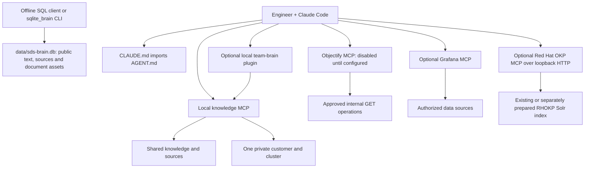

# Architecture and operating boundaries

## Components

The instruction file controls the investigation process and points to retrievable knowledge. The knowledge server performs local keyword ranking; it does not execute commands, fetch URLs or inspect infrastructure. Source references are indexed as metadata, separately from actual document bodies. Their presence does not imply their manuals are available offline.

Public vendor text is now explicitly bundled under `knowledge/vendor/`. Original downloads, pinned StorageGRID source files, legal notices and capture hashes live under `vendor-sources/`; only the normalized text enters the search index. The offline coverage report distinguishes those document bodies from source-catalog records and unavailable targets. No runtime web retrieval is added. Search initially favors different documents and explicit documentation families so duplicate chunks and alternate editions cannot crowd out all other relevant hits; requested version filters still apply before ranking diversity.

Objectify is a separate network adapter with a fixed HTTPS origin, fixed candidate paths and a reviewed OpenAPI/mapping contract. It does not expose a generic request tool. Grafana integration carries four official v2.2.0 release archives. A local Python launcher selects the platform, verifies the archive and extracted executable, and starts a fixed read-only stdio profile with explicit internal connection settings. Runtime downloads are unavailable; refresh is an explicit connected-host task. The upstream executable has its own protocol implementation and backend permissions remain mandatory.

The optional Red Hat OKP MCP is deployed separately through the Linux/Podman templates in `deploy/podman/`. It queries RHOKP over its internal network and provides a loopback HTTP endpoint for the client. The local knowledge server does not query that index. OKP container images, entitled portal content and access keys are not bundled. Source review is pinned in `mcp/okp/upstream-source.json`; runtime image identity and corpus applicability require internal acceptance.

The optional local Claude plugin keeps the reference `plugins/team-brain` path hierarchy while delegating retrieval to the same SDS knowledge implementation. It resolves the project through explicit `SDS_BRAIN_DIR` when installed into a client cache, and preserves customer/cluster startup binding. Hooks do not pull or push Git repositories. The hypershift names remain for layout compatibility; they do not establish an SDS Kubernetes deployment. See [PLUGIN.md](PLUGIN.md).

The added SQLite file is a separate persistent, portable public-document snapshot. FTS5 indexes document text; ordinary SQL tables retain provenance and the original document bytes. Source links remain distinct from saved content. Binaries, private trees, local credentials, customer imports, caches and the database itself do not enter its corpus. Read/query commands open it read-only, with result limits. Rebuild explicitly after public document changes; the original Markdown and vendor files remain the canonical editable sources. The current MCP continues to use its in-memory index. See [SQLITE.md](SQLITE.md).

## Customer isolation

Use one restricted workspace/runtime and fresh Claude session per customer. An operator may reuse the shared public/reference repository as a base, then mount only that customer's approved content and credentials. The knowledge process can be fixed further to one cluster. The private importer requires both scope fields on each imported page.

The committed `.mcp.json` launches shared retrieval only. `config/knowledge-private.example.json` supplies startup customer/cluster arguments for a private session; the README shows the explicit client launch. Running the server with `--check` alone does not reconfigure Claude.

This is defense against accidental data mixing, not a replacement for OS permissions, Confluence page restrictions, Grafana permissions, Elasticsearch index authorization or Objectify backend authorization. Claude's file tools, shell tools, other MCPs and conversation history are outside the knowledge server's access filter. Do not mount unrelated customer trees in the same agent environment.

Shared catalog entries must not contain credentials, customer names, internal hostnames or private support case content. Versioned vendor references and anonymized general procedures can be shared only within their permitted audience. `private/`, local configs and imported vendor corpora are excluded by `.gitignore`; this does not prevent an operator from overriding Git exclusions.

## Knowledge lifecycle

1. Capture a symptom, source or finding in a scoped private note or review branch.
2. Search existing pages to avoid duplicate/conflicting procedures.
3. Record product/build, customer scope, timestamp, evidence label and source links/hash.
4. Review for technical correctness, relevance, credentials and audience.
5. Promote appropriate content into knowledge/runbooks; keep customer incidents restricted.
6. Re-index, validate and run the retrieval/regression checks.
7. Review stale entries after upgrades, incidents or the 90-day review interval.

No automatic learning hook writes to a shared branch. These steps are explicit team procedures with supplied templates. Source refresh is operator-triggered; this initial package does not install a scheduled task.

## Version strategy

Store exact installed identity in private context, evidence scope in each knowledge page, and documentation version/status in the source catalog. A version filter in search is a text metadata filter; it does not compute support or compatibility. Inspect the returned source version and verify the full build before applying advice.

Red Hat and IBM may package related upstream Ceph differently. AWS, RGW and StorageGRID can differ at the operation/header/policy level. HPE manuals are generation-dependent. A custom exporter can change metric naming and semantics independently of a backend upgrade. Those are reasons to preserve provenance instead of flattening all guidance into a single undifferentiated manual.

## Retrieval limits

The stdlib implementation builds an in-memory BM25-style index at process startup. It indexes authored Markdown plus reviewed local imports, with limits of 4 MiB per document, 256 MiB of body/title/metadata content, 10,000 documents and 100,000 chunks. Catalog references also consume corpus/document/chunk capacity. Titles are limited to 512 characters; frontmatter, serialized document metadata and individual catalog records are each limited to 8 KiB. The MCP adds a 256 KiB cap on serialized tool-content payloads. It rejects symlinked source directories and indexed files. Partition a large vendor corpus by product/version/customer rather than raising limits without testing memory use. The content-byte limit is not a process-RAM limit; the in-memory token index also consumes memory.

`brain_read` accepts only IDs already present in the process index. It never turns a model-supplied value into a filesystem read. Tool output is bounded and returns scope/provenance. Restart after changing imported files; the MCP does not watch the filesystem or read the added SQLite snapshot automatically. Its in-memory limits are independent of the SQLite builder's limits.

## Protocol scope

The two SDS Python MCP implementations are deliberately small: initialization, ping, tool discovery and tool calls over stdio, with bounded input. It supports only revision **2025-11-25**, using the [MCP lifecycle](https://modelcontextprotocol.io/specification/2025-11-25/basic/lifecycle) and [stdio transport](https://modelcontextprotocol.io/specification/2025-11-25/basic/transports). Other initialization versions receive this revision as a counteroffer. Unknown error IDs are omitted; readable IDs are preserved. It has no HTTP listener, older batch-message support, tasks, sampling, resource subscriptions or modern stateless-only lifecycle. Unsupported methods receive an error. Native client interoperability remains an environment acceptance check.
